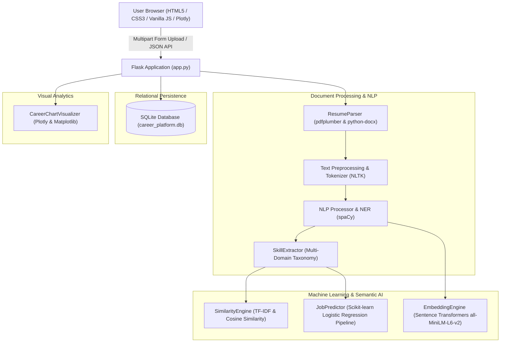

# Aurevia AI — AI-Powered Resume Analyzer & Career Intelligence Platform

Aurevia AI is an advanced, production-ready AI/ML web application engineered to transform candidate resumes into actionable career intelligence. Built with Python, Flask, Scikit-learn, Sentence Transformers, spaCy, NLTK, SQLite, and vanilla ES6+ JavaScript, the platform integrates nine core career intelligence modules alongside advanced product features such as raw job description analysis, resume version comparison, and an interactive AI career companion.

---

## 🌟 Key Modules & Capabilities

1. **Resume Intelligence (Module 1)**: Robust PDF (`pdfplumber`) and DOCX (`python-docx`) parsing, extracting candidate contact information, education, structured summaries, and multi-domain technical competencies.
2. **ATS Compatibility Engine (Module 2)**: Explainable 100-point resume scoring assessing section completeness, keyword relevance, quantifiable impact metrics, and Flesch readability ease.
3. **Job Match Explorer (Module 3)**: Trained Scikit-learn classification pipeline predicting the candidate's top 5 suitable career roles with confidence scores and required skill comparisons.
4. **Skill Gap Detector (Module 4)**: Compares existing candidate skills against benchmark target role taxonomies, categorizing gaps by priority and suggesting strategic next steps.
5. **AI Resume Improver (Module 5)**: Provides side-by-side Before/After transformations for bullet points using Google's XYZ formula, detects weak verbs, and suggests high-impact power action verbs without fabricating achievements.
6. **Personalized Learning Roadmap (Module 6)**: Generates week-by-week learning milestones organized across Beginner, Intermediate, and Advanced tiers, complete with recommended portfolio capstone projects and industry certifications.
7. **AI Mock Interview Simulator (Module 7)**: Generates tailored technical, behavioral (STAR method), and HR interview questions. Evaluates candidate answers using Semantic AI embeddings (`Sentence Transformers`) for relevance and clarity with exemplary benchmark answers.
8. **Personalized Cover Letter Generator (Module 8)**: Synthesizes genuine qualifications, technical skills, and experience into tailored cover letters adapted to target companies and roles.
9. **Career Dashboard (Module 9)**: Real-time command center featuring interactive Plotly gauge charts, ML role match distributions, Matplotlib skill alignment figures, and historical tracking.
10. **Additional Intelligence Tools**:
    - **Job Description Deep Analyzer**: Extracts required skills, experience levels, and degrees from raw job postings.
    - **Resume Version Comparison**: Semantic difference and keyword addition analysis between two resume versions.
    - **Aure AI Career Buddy**: Interactive companion connected to the backend for real-time career guidance.
    - **Markdown Report Exporter**: Downloadable career intelligence audit reports.

---

## 🏗️ System Architecture



---

## 📁 Project Directory Structure

```
AI-Resume-Analyzer/
├── app.py                     # Flask application & REST API routes
├── config.py                  # Environment and application configuration
├── requirements.txt           # Python dependency specifications
├── Dockerfile                 # Multi-stage production container definition
├── Procfile                   # Process file for PaaS deployments (Railway/Heroku)
├── render.yaml                # Render cloud deployment blueprint
├── README.md                  # Comprehensive platform documentation
├── TECH_STACK_IMPLEMENTATION.md # Detailed tech stack verification report
├── .env.example               # Environment variables template
├── .gitignore                 # Version control exclusions
│
├── frontend/
│   ├── templates/
│   │   └── index.html         # Unified single-page Saas UI for all 9 modules
│   └── static/
│       ├── css/
│       │   └── style.css      # Celestial theme, 3D visual physics, responsive styling
│       └── js/
│           └── script.js      # Vanilla JavaScript client orchestration & API bridge
│
├── backend/
│   ├── resume_parser.py       # PDF/DOCX extraction engine
│   ├── text_preprocessing.py  # Cleaning, boundary tokenization, stopwords
│   ├── nlp_processor.py       # Contact info, NER, and section parsing
│   ├── skill_extractor.py     # Multi-domain skill taxonomy engine
│   ├── similarity_engine.py   # TF-IDF vectorization and cosine similarity
│   ├── embedding_engine.py    # Sentence Transformers semantic vector engine
│   ├── job_predictor.py       # ML role classifier inference
│   ├── ats_analyzer.py        # ATS compatibility scoring & readability
│   ├── skill_gap_analyzer.py  # Gap detection & prioritized trajectories
│   ├── resume_improver.py     # XYZ bullet point and summary enhancer
│   ├── learning_roadmap.py    # Tiered week-by-week curriculum generator
│   ├── mock_interview.py      # Q&A generator & semantic evaluation
│   ├── cover_letter_generator.py # Structured cover letter generator
│   ├── career_dashboard.py    # Telemetry and state aggregation
│   └── recommendation_engine.py # Projects, pathways, and JD analyzer
│
├── database/
│   ├── db.py                  # SQLite connection and schema migrations
│   └── models.py              # Relational models and query methods
│
├── ml_models/
│   ├── train_model.py         # Dataset generation & ML training pipeline
│   ├── datasets/              # Labelled resume-job training datasets
│   └── saved_model/           # Serialized joblib classifier & metrics JSON
│
├── visualizations/
│   └── charts.py              # Plotly JSON and Matplotlib base64 generators
│
├── uploads/                   # Temporary upload directory
├── reports/                   # Exported career audit reports
└── tests/
    └── test_app.py            # Comprehensive 15-point unit & integration test suite
```

---

## 🚀 Getting Started Locally

### 1. Prerequisites
- Python 3.10, 3.11, 3.12, 3.13, or 3.14.
- pip package manager.

### 2. Clone / Open Project Directory
```bash
cd "C:\Users\hp\.gemini\antigravity\scratch\AI-Resume-Analyzer"
```

### 3. Create and Activate Virtual Environment (Optional but Recommended)
```bash
python -m venv venv
# On Windows:
venv\Scripts\activate
# On Linux / macOS:
source venv/bin/activate
```

### 4. Install Dependencies
```bash
pip install -r requirements.txt
```

### 5. Train the Machine Learning Classifier
```bash
python ml_models/train_model.py
```
*Note: This generates the labelled dataset across 11 roles, evaluates model metrics, and saves the trained pipeline to `ml_models/saved_model/job_predictor_model.pkl`.*

### 6. Run the Test Suite
```bash
python tests/test_app.py
```
*All 15 unit and integration tests should pass with `OK`.*

### 7. Start the Flask Web Server
```bash
python app.py
```
Open your browser and navigate to:
```
http://localhost:5000
```

---

## 🚢 Deployment Instructions

### A. Docker Deployment
```bash
# Build the Docker image
docker build -t aurevia-ai-resume-analyzer .

# Run the container
docker run -d -p 5000:5000 --name aurevia-app aurevia-ai-resume-analyzer
```
Navigate to `http://localhost:5000`.

### B. Render Deployment
1. Connect your GitHub repository to Render.
2. Select **New Web Service** and choose **Docker** as the runtime.
3. Render automatically picks up `render.yaml` or `Dockerfile`.
4. Set environment variable: `PORT = 10000`.
5. Deploy.

### C. Railway Deployment
1. Log in to Railway and create a **New Project from GitHub Repo**.
2. Railway detects the `Dockerfile` and `Procfile`.
3. Add a persistent volume mounted to `/app/database` if you wish to persist the SQLite database across restarts.
4. Set `PORT` (Railway provides dynamic port assignment).
5. Deploy.

### D. AWS Deployment (ECS / Fargate)
1. Push Docker image to Amazon Elastic Container Registry (ECR).
2. Create an Amazon ECS Task Definition pointing to the ECR image with 1 vCPU and 2GB RAM.
3. Launch an ECS Service on AWS Fargate behind an Application Load Balancer (ALB).
4. Configure an Amazon EFS volume if persistent SQLite storage is required, or configure an Amazon RDS PostgreSQL instance.

---

## 🧪 Testing Coverage

The automated test suite in `tests/test_app.py` validates:
- Text cleaning, tokenization, and stopword removal.
- Boundary-safe skill extraction across all 8 technical categories.
- NLP contact detail and education degree detection.
- TF-IDF and Cosine Similarity computations.
- Dense semantic similarity via Sentence Transformers / embedding engine.
- Scikit-learn Job Prediction Pipeline accuracy and confidence scores.
- 100-point ATS evaluation and section audit.
- Skill gap detection and priority ranking.
- XYZ formula bullet point and summary improvements.
- Learning roadmap tier generation.
- Mock interview question generation and semantic answer evaluation.
- Personalized cover letter generation.
- SQLite database CRUD operations and relational integrity.
- Flask REST API endpoints and error handlers.
- DOCX binary document parsing.

Run all tests anytime with:
```bash
python tests/test_app.py
```
